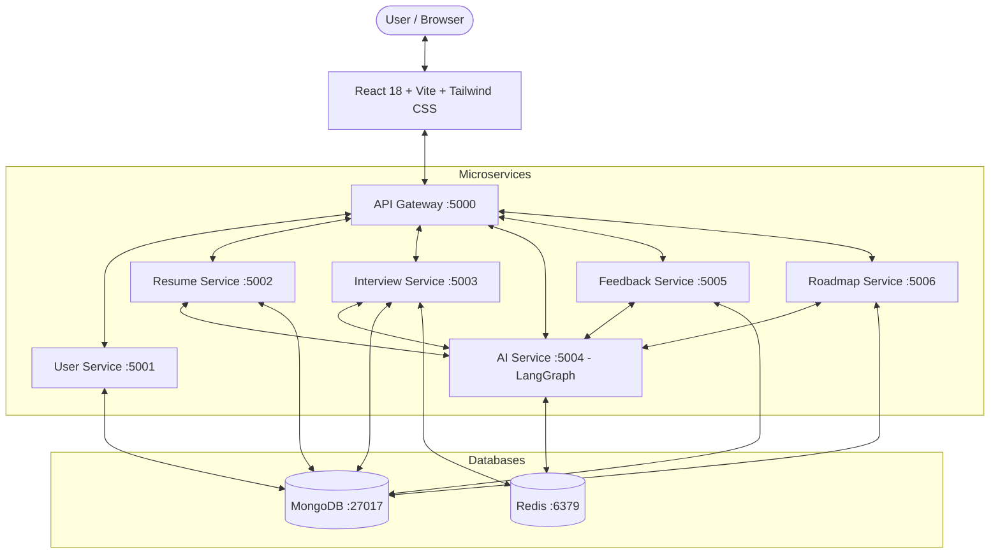

# 🚀 PrepAI — AI Interview & Career Preparation Platform

> An intelligent, full-stack career coach that conducts realistic AI interviews, analyzes resumes, generates actionable feedback, identifies skill gaps, and builds personalized step-by-step learning roadmaps.

---

## 🌟 Core Features

- **🎙️ Real-Time AI Mock Interviews**:
  - Interactive voice & text interview interface.
  - Multi-topic structured interviews (Technical DSA, DBMS, OS, OOP, System Design, HR Behavioral).
  - Dynamic question generation and adaptive follow-ups powered by LangGraph state machines.
  - Real-time scoring, live feedback, and comprehensive post-interview performance breakdowns.
- **📄 AI Resume Analyzer**:
  - Drag-and-drop resume upload (PDF / DOCX).
  - 6-dimension radar scoring (Skills, Experience, Education, Projects, Structure, Keywords).
  - Automated extraction of skills, experience highlights, strengths, and missing industry keywords.
- **💬 Deep Actionable Feedback**:
  - Categorized strengths and specific improvement areas.
  - Quantitative skill ratings and targeted practice recommendations with curated study resources.
- **🗺️ Personalized Learning Roadmap**:
  - Phase-by-phase learning path tailored to your target role and identified interview weak spots.
  - Interactive checklists to mark topics done and watch overall readiness progress update live.
- **📊 Comprehensive Career Dashboard**:
  - Track interview history, average and best scores, mastered skills, and ongoing roadmaps.

---

## 🏗️ Architecture



---

## 💻 Tech Stack

| Layer | Technology |
|---|---|
| **Frontend** | React 18, TypeScript, Vite, Tailwind CSS, Framer Motion, Recharts, Lucide Icons, Axios |
| **API Gateway** | Express.js, `http-proxy-middleware`, Helmet, CORS, Rate Limiting, Firebase Admin Auth |
| **Microservices** | Node.js, Express.js, Mongoose, Redis Client, Multer |
| **AI & LLM** | LangGraph, LangChain, OpenAI / Groq / OpenRouter API abstraction, Smart Fallback Engine |
| **Databases** | MongoDB 7.0 (Mongoose schemas), Redis 7.2 (Interview session caching) |
| **DevOps** | Docker, Docker Compose, Nginx |

---

## 🚀 Quick Start with Docker Compose

To spin up the entire platform including all microservices, MongoDB, Redis, and the frontend with a single command:

```bash
# 1. Clone repository & configure environment
cp .env.example .env

# (Optional: Add your AI_API_KEY in .env for live LLM responses)

# 2. Build and launch all services
docker compose up -d --build

# 3. Open in your browser:
# Frontend: http://localhost:5173
# API Gateway: http://localhost:5000/health
```

---

## 🛠️ Local Development (Without Docker)

### 1. Prerequisites
- Node.js >= 18.x
- MongoDB running on `mongodb://localhost:27017`
- Redis running on `redis://localhost:6379` (optional — in-memory fallback enabled automatically)

### 2. Install Dependencies
```bash
npm run install:all
```

### 3. Run Microservices & Frontend
You can launch individual services or use npm scripts:

```bash
# Terminal 1: API Gateway (Port 5000)
npm run dev:gateway

# Terminal 2: User Service (Port 5001)
npm run dev:user

# Terminal 3: Resume Service (Port 5002)
npm run dev:resume

# Terminal 4: Interview Service (Port 5003)
npm run dev:interview

# Terminal 5: AI Service (Port 5004)
npm run dev:ai

# Terminal 6: Feedback Service (Port 5005)
npm run dev:feedback

# Terminal 7: Roadmap Service (Port 5006)
npm run dev:roadmap

# Terminal 8: Frontend (Port 5173)
npm run dev:frontend
```

---

## 🔌 API Gateway Endpoints

| Method | Endpoint | Service Proxy | Description |
|---|---|---|---|
| `GET` | `/health` | API Gateway | Service health status |
| `POST` | `/api/users/sync` | User Service (:5001) | Synchronize Firebase user |
| `GET` | `/api/users/me` | User Service (:5001) | Get current user profile |
| `GET` | `/api/users/me/stats` | User Service (:5001) | Dashboard statistics |
| `POST` | `/api/resumes/upload` | Resume Service (:5002) | Upload resume & analyze |
| `GET` | `/api/resumes` | Resume Service (:5002) | List all user resumes |
| `GET` | `/api/resumes/:id` | Resume Service (:5002) | Get specific resume analysis |
| `POST` | `/api/interviews` | Interview Service (:5003) | Initialize interview session |
| `POST` | `/api/interviews/:id/start` | Interview Service (:5003) | Start interview & get first Q |
| `POST` | `/api/interviews/:id/answer` | Interview Service (:5003) | Submit answer, get evaluation |
| `POST` | `/api/interviews/:id/complete` | Interview Service (:5003) | Complete interview & generate report |
| `GET` | `/api/interviews/:id/result` | Interview Service (:5003) | Get overall score & breakdown |
| `GET` | `/api/feedback/latest` | Feedback Service (:5005) | Get latest comprehensive feedback |
| `GET` | `/api/roadmaps/active` | Roadmap Service (:5006) | Get active career roadmap |
| `PATCH` | `/api/roadmaps/:id/progress` | Roadmap Service (:5006) | Update topic completion |
| `POST` | `/api/ai/chat` | AI Service (:5004) | Chat with AI Career Coach |

---

## 🔒 Authentication & Demo Mode

The platform supports **Firebase Authentication** (Email/Password & Google Sign-In).
When Firebase credentials are not provided in development, the platform automatically runs in **Zero-Config Development Mode**:
- API Gateway attaches dev-user headers seamlessly.
- Frontend includes rich mock data and offline fallback modes.
- You can test and demonstrate all features immediately out of the box!
